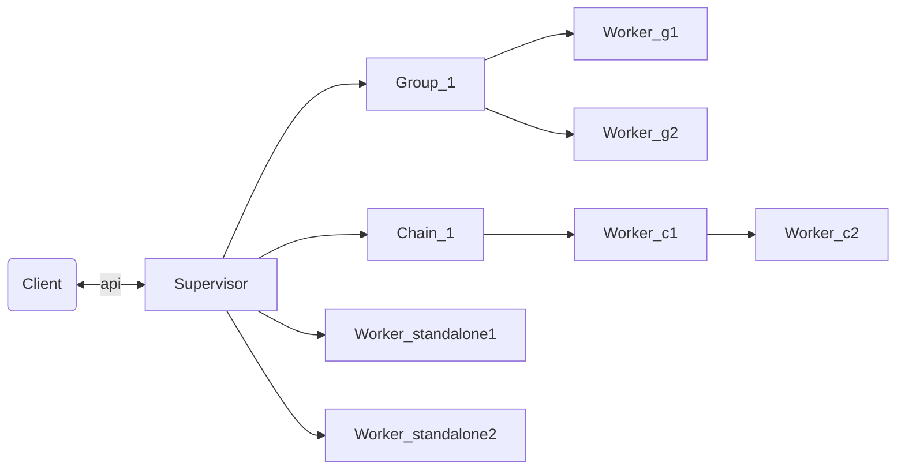
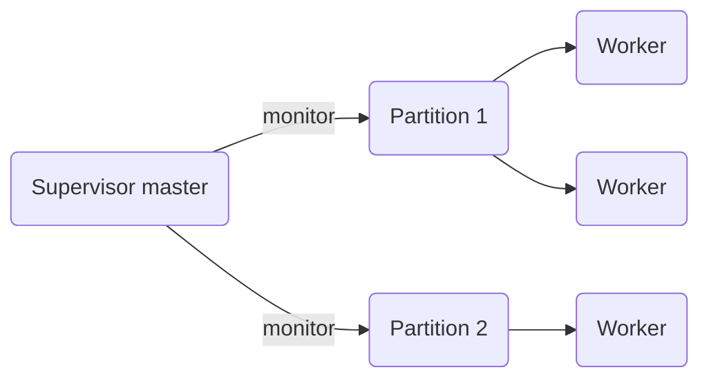

# SuperWorker Supervisor Guide

`SuperWorker.Supervisor` is an all-in-one supervisor for Elixir applications. It
supports three kinds of processes — groups, chains and standalone workers — that
can be declared in config or added at runtime, each with its own restart
strategy, and addressed directly by id.

> Which primitive do I need? A **supervisor** keeps long-lived processes alive
> and restarts them on crashes. A [**pool**](../pool/POOL_GUIDE.md) distributes
> short jobs over workers without keeping processes per job. A
> [**FunctionChain**](../function_chain/FUNCTION_CHAIN_GUIDE.md) is an
> in-process pipeline with no processes at all. The supervisor can also run
> pools of workers (groups) and process pipelines (chains) — this guide covers
> those, plus how to embed a FunctionChain inside supervisor workers.

## Overview

One supervisor manages an arbitrary mix of process types:



| Type          | Purpose                                            | Restart strategies                                    |
|---------------|----------------------------------------------------|-------------------------------------------------------|
| `:group`      | A set of workers sharing a group id                | `:one_for_one`, `:one_for_all`                        |
| `:chain`      | Ordered workers where each passes data to the next | `:one_for_one`, `:one_for_all`, `:rest_for_one`       |
| `:standalone` | Independent worker with its own strategy           | `:permanent`, `:transient`, `:temporary`              |

Restart strategies only apply to crashes: normal exits, `:shutdown` and
`:terminate` are never restarted. Full definitions live in
[Error handling](#error-handling) below.

## When to use

Use the supervisor when you need **durable, addressable processes**: workers
that stay alive, receive messages by id, and are restarted on failure. Prefer
the [Pool Guide](../pool/POOL_GUIDE.md) for fire-and-submit background jobs
with no per-job process, and the
[FunctionChain Guide](../function_chain/FUNCTION_CHAIN_GUIDE.md) for
composable data transformations running in the calling process.

## Quick start

```elixir
alias SuperWorker.Supervisor, as: Sup

# Start a supervisor with 2 partitions.
{:ok, _} = Sup.start_with_config([id: :sup1, num_partitions: 2, link: false])
```

Supervisor options:

```elixir
[
  id: :sup1,                # atom id, used by every API call
  num_partitions: 2,        # default: System.schedulers_online()
  link: false,              # link the supervisor to the caller (default: true)
  report_to: []             # pids/callbacks to report worker events to
]
```

With `link: false` the supervisor is not linked to the starting process, so it
survives the caller — handy in tests and `iex` sessions. The default `true`
links it like a normal OTP child. Later examples omit these options and use
`:sup1` unless a setting matters.

## Core concepts

Each supervisor has one master process plus a number of partition processes.
When a supervisor API is called, the master picks a partition and forwards the
request to it, so a high volume of workers/requests does not bottleneck a single
process.

Worker, group, chain and runtime information is kept in an ETS table shared by
the partitions.

### Fault tolerance

Workers are spread over one or more partitions. Each partition is a plain
process monitored by the supervisor master:

- a crashing **worker** is restarted by its partition according to the restart
  strategy of its parent (standalone/group/chain) — one bad worker never
  affects workers on other partitions;
- a crashing **partition** is detected via a monitor and restarted
  individually; the rest of the supervisor keeps serving requests;
- partitions monitor the master, so nothing survives the supervisor itself;
- link semantics with the process that started the supervisor are standard: an
  abnormal exit of that process stops the supervisor, a `:normal` exit does not.



This is the canonical fault-tolerance description; the
[Pool Guide](../pool/POOL_GUIDE.md) links here and documents only its
pool-specific additions (front-of-queue retry, poison-pill safety,
`:on_failure`).

## Groups

All processes in a group share the same group id. Group workers support
broadcasting and direct messaging without any custom message protocol.

```elixir
# Add groups at runtime (also possible in config).
{:ok, _} = Sup.add_group(:sup1, [id: :group1, restart_strategy: :one_for_all])
{:ok, _} = Sup.add_group_worker(:sup1, :group1, {Dev, :task, [15]}, [id: :g1_1])

# A group with an anonymous function worker.
{:ok, _} =
  Sup.add_group(:sup1, [id: :group2, restart_strategy: :one_for_one])

{:ok, _} =
  Sup.add_group_worker(:sup1, :group2, fn ->
    receive do
      {:ping, ref, from} -> send(from, {:pong, ref})
      _ -> :ok
    end
  end, [id: :g2_2])

# Messaging
ref = make_ref()
Sup.send_to_group_worker(:sup1, :group2, :g2_2, {:ping, ref, self()})
Sup.broadcast_to_group(:sup1, :group1, {:reload, :config})
Sup.send_to_group_random(:sup1, :group1, {:work, job})   # any idle-ish worker

receive do
  {:pong, ^ref} -> :ok
end
```

Group API summary:

| Function                                          | Purpose                  |
|---------------------------------------------------|--------------------------|
| `add_group/2`                                     | Create a group           |
| `add_group_worker/4`                              | Add a worker (fun, MFA or module) |
| `send_to_group_worker/4`                          | Message a specific worker by id |
| `send_to_group_random/3`                          | Message a random worker in the group |
| `broadcast_to_group/3`                            | Send to all workers in the group |
| `count_workers_in_group/2`                        | Number of workers        |
| `get_pid_group_worker/3`                          | Get a worker's pid       |
| `restart_group_worker/3`, `restart_group/2`       | Manual restarts          |
| `remove_group_worker/3`, `remove_group/2`         | Removal                  |

## Chains

Chain workers run in order: the output of one node is passed to the next.

```elixir
{:ok, _} = Sup.start_with_config(link: false, id: :sup1, num_partitions: 1)
{:ok, _} =
  Sup.add_chain(:sup1,
    id: :chain1,
    restart_strategy: :one_for_one,
    finished_callback: {:fun, fn data -> IO.inspect(data, label: "finished") end}
  )

{:ok, _} = Sup.add_chain_worker(:sup1, :chain1, fn data -> {:next, data + 1} end, id: 1)
{:ok, _} = Sup.add_chain_worker(:sup1, :chain1, fn data -> {:next, data * 2} end, id: 2)

# Push data into the first node of the chain.
{:ok, _} = Sup.send_to_chain(:sup1, :chain1, 10)
```

Node functions return:

- `{:next, data}` or a plain value: forward `data` to the next node.
- `{:drop, reason}` / `{:error, reason}`: stop forwarding, keep the worker alive.
- `{:stop, reason}`: stop the worker.

### Entering a chain

Data enters a chain at its first node. `Sup.add_chain_worker/5` adds a
single-replica node at the end of the chain.

### Queue and backpressure

Nodes process messages in order. Each node confirms its upstream message, and
the queue per node is bounded by `:queue_length` (default 50). A node waits up
to 5 seconds for downstream confirmation when its queue is full, then exits
with `:queue_full`.

### Finished callbacks and routing

If the last node forwards data, the chain's `:finished_callback` runs with the
data. It accepts `{:fun, fun/1}` or `{module, function, args}`.

`:send_type` selects which replica of the next node receives a message. It
applies to multi-replica nodes, which are created through the `Chain` module
(`%Worker{num_workers: n}`). With single-replica nodes every type behaves the
same:

- `:broadcast`: every live replica.
- `:random`: one random live replica.
- `:round_robin`: live replicas in turn.
- `:partition`: the replica chosen by a hash of the data (same data, same replica).

### Restart strategies

Restart strategies apply when a chain worker terminates abnormally (a normal
exit is never restarted) — see [Error handling](#error-handling) for the full
definitions:

- `:one_for_one`: restart only the failed worker.
- `:one_for_all`: restart every worker of the chain.
- `:rest_for_one`: restart the failed worker and every later node; earlier
  nodes keep running.

Chain workers stay alive while idle; they are not restarted for inactivity.

### Removing workers

`Sup.remove_chain_worker/3` returns `:ok` or `{:error, :worker_not_found}`.
Removing a node shifts later nodes down so the chain stays contiguous.

A message sent to a worker that is being restarted is dropped and logged.

## Standalone workers

Standalone workers are independent: a crash never affects other standalone
workers or workers in groups/chains.

```elixir
# By MFA, anonymous fun, or a GenServer module.
{:ok, _} = Sup.add_standalone_worker(:sup1, {MyApp.Fetcher, :poll, []}, [id: :fetcher])
{:ok, _} = Sup.add_standalone_worker(:sup1, fn -> schedule_work() end, [id: :cron])

# Message a standalone worker by id.
Sup.send_to_standalone_worker(:sup1, :fetcher, {:poll, :now})

Sup.get_pid_standalone_worker(:sup1, :fetcher)
Sup.remove_standalone_worker(:sup1, :fetcher)
```

Standalone restart strategies follow the OTP semantics — see
[Error handling](#error-handling): `:permanent` (always restarted),
`:transient` (restarted on abnormal exit), `:temporary` (never restarted).

## Running a FunctionChain in the supervisor

`SuperWorker.Supervisor.FunctionChain` bridges a `SuperWorker.FunctionChain`
(the in-process pipeline) into supervisor workers. Step retry/ignore policies
are defined by the FunctionChain — see the
[FunctionChain Guide](../function_chain/FUNCTION_CHAIN_GUIDE.md) for chain
options (retry, branches, checkpoint/resume).

As a **chain node** — each message flowing through the process chain is run
through the FunctionChain, the result is forwarded to the next node:

```elixir
chain =
  SuperWorker.FunctionChain.new()
  |> SuperWorker.FunctionChain.add(:fetch, {MyApp.Users, :fetch, []})
  |> SuperWorker.FunctionChain.add(:normalize, fn user -> {:ok, normalize(user)} end)

{:ok, _} = Sup.add_chain(:sup1, [id: :chain1, restart_strategy: :one_for_one])

{:ok, _} =
  Sup.add_chain_worker(
    :sup1,
    :chain1,
    SuperWorker.Supervisor.FunctionChain.chain_node_fun(chain),
    [id: :fc_node]
  )
```

As a **standalone or group worker** — a job loop runs every received message
through the chain. `{:run, ref, job, from}` is a request/response envelope
(reply to `from`); any other message is fire-and-forget (result goes to
`:on_result`):

```elixir
{:ok, _} =
  Sup.add_standalone_worker(
    :sup1,
    SuperWorker.Supervisor.FunctionChain.job_loop(chain, on_result: fn job, result -> ... end),
    [id: :fc]
  )

# Request/response
ref = make_ref()
Sup.send_to_standalone_worker(:sup1, :fc, {:run, ref, job, self()})

receive do
  {:super_worker_function_chain, ^ref, result} -> result
end
```

## Error handling

This is the canonical definition of **process** restart strategies (groups,
chains, standalone workers). For **step** retry policies inside a
FunctionChain (`:halt`/`:retry`/`:ignore`), see the
[FunctionChain Guide](../function_chain/FUNCTION_CHAIN_GUIDE.md).

Strategies only apply to crashes — normal exits, `:shutdown` and `:terminate`
are never restarted:

- Group/chain strategies:
  - `:one_for_one`: restart only the failed worker.
  - `:one_for_all`: restart every worker of the group/chain.
  - `:rest_for_one` (chains only): restart the failed worker and every later
    node; earlier nodes keep running.
- Standalone strategies (OTP semantics):
  - `:permanent`: always restarted.
  - `:transient`: restarted on abnormal exit only.
  - `:temporary`: never restarted.

## Introspection

```elixir
# All supervisors started by the library on this node.
Sup.running_supervisors()
# [{:sup1, #PID<0.200.0>}]

# Partition health + counts of groups/chains/workers.
{:ok, info} = Sup.supervisor_info(:sup1)
info.num_groups
info.partitions |> Enum.all?(& &1.alive?)

# List groups/chains/standalone workers with their configuration.
{:ok, groups} = Sup.list_groups(:sup1)
{:ok, chains} = Sup.list_chains(:sup1)
{:ok, workers} = Sup.list_standalone_workers(:sup1)
```

## Declarative configuration

Supervisors, groups, chains and workers can also be declared in
`config/config.exs` or `config/runtime.exs` and started automatically when the
application boots. See the [Config Guide](../config/CONFIG_GUIDE.md) and the
[Config Quickstart](../config/CONFIG_QUICKSTART.md).

## Next steps

- [Pool Guide](../pool/POOL_GUIDE.md) — a partitioned job pool for submitting jobs.
- [FunctionChain Guide](../function_chain/FUNCTION_CHAIN_GUIDE.md) — composable in-process pipelines.
- [Config Guide](../config/CONFIG_GUIDE.md) — declarative supervisor trees in config files.
